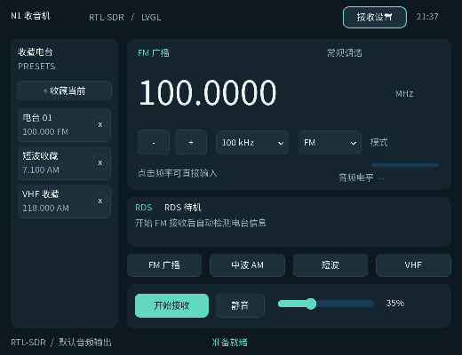
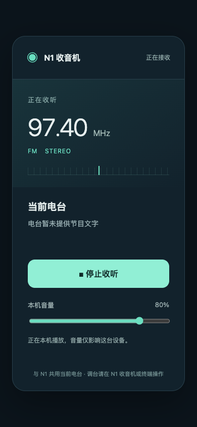

# N1 收音机 · LVGL Radio

为斐讯 N1 / Debian 12 arm64 编写的轻量 RTL-SDR 收音机。界面使用已移植的 LVGL，接收和解调复用 `rtl_fm`，音频通过 PulseAudio 输出。无需 GNU Radio 或 Gqrx。



## 功能

- 大号频率显示，支持直接输入 MHz、100Hz～1MHz 步进调台。
- FM 广播单声道、AM、USB、LSB、NFM；常用 FM / 中波 / 短波 / VHF 入口。
- FM RDS：电台名称、节目文字、PI 和节目类型。无数据时明确显示“未检测到 RDS”，调台后清空旧台信息。
- 默认以 50% 缩放显示，实际窗口为 520×400，鼠标坐标同步换算；完成布局后才显示窗口，避免启动时先大后小。
- 音量、静音、音频电平显示，以及最多 16 个命名收藏电台。
- 常规 R820T 调谐、Q 路直采、上变频频移、射频增益与 ppm 校准设置。
- FM 使用 240kHz 原生解调、增强 I/Q 降采样和 193 抽头抗混叠滤波，再输出 48kHz 单声道，抑制导频与立体声分量折叠造成的杂音。显式设置宽带 FM，避免 rtl_fm 的 wbfm 别名附带的 16kHz 调谐偏移，保留足够频偏余量。默认手动射频增益 25.4dB，可在设置中调整或切回自动。
- 独立接收线程，不阻塞 LVGL；调台和停止会清理子进程并释放接收棒。
- 收藏与设置原子保存到 `$XDG_CONFIG_HOME/n1-radio/settings.ini`，默认 `~/.config/n1-radio/settings.ini`。
- 启动器提供 256MiB 应用内存上限、32MiB 应用 swap 上限。不会更改系统 swap。

音频电平是 **PCM 音频电平，非 RF 信号强度**。当前没有频谱瀑布图、自动搜台或立体声。RDS 解码不要求音箱播放立体声。

## 低频短波的硬件限制

普通 RTL2838 + R820T 的常规调谐约从 24MHz 开始。界面提供 AM / USB / LSB 解调，不表示任意接收棒都能接收低频短波：

- 低于 24MHz，需要接收棒本身具备 Q 路直采硬件，或外接上变频器。
- 直采请在“接收设置”中选择，仅用于 28.8MHz 以下；普通板卡的 Q 引脚可能没有连接天线。
- 使用上变频器时，填写设备实际频移。应用调谐硬件频率 = 界面频率 + 频移。
- 默认频移栏为常见的 125MHz 示例值，不代表检测到了上变频器。
- 软件不会自动打开 Bias-T。

FM 支持导频锁定的自动立体声：从 19kHz 导频恢复 38kHz 副载波，解码 L−R，与 L+R 合成左右声道，以 48kHz 双声道输出。导频丢失时平滑回退为相同的左右声道。AUTO/MONO 按钮可强制单声道；锁定并完成立体声混合后界面才显示 FM STEREO。AM/USB/LSB/NFM 保持单声道。RDS 与立体声分别检测，收到 RDS 不代表立体声锁定。

## 使用

从 XFCE 的“应用菜单 → 多媒体 → N1 收音机”打开，或运行：

```sh
n1-radio
```

先退出 Gqrx、rtl_test 等占用接收棒的程序。点击“开始接收”，调到当地电台频率。点击数字可直接输入频率；“收藏当前”保存频率和解调模式，右侧 x 移除收藏。硬件输入方式为全局设置。

未接收时不占用 RTL2838；关闭窗口或停止接收会释放它。设备被占用、USB 掉线和音频服务错误会显示在状态栏，不会把设备打开失败显示为正常接收。

## 安装已编译版本

从本仓库 Releases 下载 arm64 压缩包，在 N1 上解压后：

```sh
sudo apt-get install --no-install-recommends rtl-sdr libsdl2-2.0-0 libpulse0 libjson-c5 libliquid1 libsndfile1
sudo python3 install.py
```

在解压目录运行安装命令。程序安装到 `/opt/n1-radio`，启动器安装到 `/usr/local/bin/n1-radio`。应用菜单中显示“N1 收音机”。不要以 root 运行图形应用，应在 n1 的 XFCE 会话启动。

## 构建

目标依赖：SDL2、PulseAudio、rtl-sdr、json-c。RDS 使用 redsea 1.3.1，依赖 liquid-dsp 和 libsndfile。LVGL SDK 来自 N1 已安装的 `/opt/lvgl/install`，配置参考 `docs/lvgl-n1.defconfig`，对应 LVGL `10.0.0-dev`，提交 `58ae125776675b7dbbd2773ae06f02bc30fdde5d`。这是开发快照，并非承诺兼容所有 LVGL 9/10 版本。

推荐在 Mac 的 ARM64 Docker 中构建，避免 N1 内存不足。将 N1 的 `/opt/lvgl/install` 复制到构建机后：

```sh
sh scripts/build-docker.sh /absolute/path/to/lvgl/install
```

脚本保留构建容器与镜像，生成 `build/n1-radio`、`build/n1-radioctl`、`build/redsea` 和解码器许可证。已有 Debian arm64 构建环境可执行：

```sh
cmake -S . -B build -DCMAKE_PREFIX_PATH=/opt/lvgl/install -DCMAKE_BUILD_TYPE=Release
cmake --build build -j3
ctest --test-dir build --output-on-failure
sh scripts/build-redsea.sh "$PWD/build/deps"
```

字体 C 源码已包含，普通构建不需要 Node / Python 字体工具。常用中文字符分成两份字体，适配现有 SDK 的小字体索引布局。字体源自 Noto Sans CJK SC，许可证见 `assets/FONT-LICENSE.txt`。修改字体可用 `scripts/make-fonts.py`，需要 fontTools、lv_font_conv 和 Noto CJK 原始字体集合；不使用系统专有字体。

## 测试

- `radio-window-test`：验证初始 SDL 窗口隐藏标志；`radio-startup-watch` 在独立 Xvfb 上观察真实 MapNotify，确认可见窗口从第一帧起就是 520×400。
- `radio-core-test`：频率与硬件范围、收藏与配置原子读写、损坏配置处理。
- `radio-dsp-test`：测试 1kHz 通带、19kHz 导频与 38kHz 立体声分量抑制，以及跨分块流式处理一致性。
- `radio-rds-test`：JSON/Unicode、台站变更、缺失与损坏数据、检测超时、分片输出、解码器缺失与异常退出。
- `radio-rds-reference-check`：用真实录制 MPX 样本验证 240kHz 输入、redsea 解码和应用元数据链路。
- `radio-engine-test`：模拟 RTL 接收器和音频服务，测试接收、音量不重启设备、连续 8 次调台、40 次快速调台合并、初始化期间取消调台、停止、设备占用后重试和退出。
- `radio-hardware-check`：需要真实接收棒与 PulseAudio；在静音状态依次验证 FM / AM / USB / LSB / NFM 产生 PCM 音频数据。`--rapid` 额外验证 30/100/300/600ms 间隔连续调台后恢复 PCM。不会证明收到具体电台或验证低频直采硬件。
- `scripts/preview.py`：在独立 Xvfb 上渲染实际 LVGL 界面，生成截图，不接收无线电。

```sh
build/radio-hardware-check
```

实机测试中修复了退出接收进程时过早关闭管道的问题：现在先发送 SIGINT，并在 USB 清理期间排空管道，再关闭文件描述符。快速调台时等待输入稳定 400ms 后只打开最终频率；若取消发生在 USB 初始化期间，则先等待首个 PCM 块或最多 1.5 秒的初始化宽限再发送 SIGINT。频率设置在停止操作 750ms 后合并保存，避免每次点击都同步写盘。USB 供电或硬件掉线仍可能需要重插。

首次用户测试发现无声：接收端 PCM 正常但输出缓冲几乎一直为空。已移除自定义的零预缓冲 / 小缓冲，改用 PulseAudio 标准缓冲，兼容蓝牙输出。

用户已在 N1 上验证：收听、缩小后的界面、中文弹窗、屏幕键盘和按钮操作正常。启动窗口映射另用实际 X11 事件验证。当前 97.4MHz 尚未检测到有效 RDS；真实录制样本的 PI 和节目类型解码已通过。

用户验收结果与最终构建信息记录在 `docs/validation.json`。按用户要求，仓库仅在用户测试确认后上传。

## RDS 信号路径

FM 复合信号在去加重和音频低通前分支送入 redsea（240kHz、s16le MPX）。收听分支单独执行 75μs 去加重、抗混叠滤波和 48kHz 输出，保留原收听响应。解码器运行在独立子进程内，输入队列和 JSON 行长度均有上限，不积累全部广播记录。解码器不可用时仍可收听。

仅当电台发送 RDS 且信号足够好时才会显示真实广播信息。PS/RadioText 不会用收藏名称或网络查询填充。短时间只有 PI 而没有名称或文字也属正常情况。改频和更换解调模式会清空旧台信息；长时间没有新有效组时提示信号暂失。

redsea 源码固定为 v1.3.1 / `4cc27df9939798e800c4ff7cb484be6d9bf68b4d`，MIT 许可证见 `assets/REDSEA-LICENSE.txt`。[上游项目](https://github.com/windytan/redsea)。

## 项目布局

- `src/main.c`：LVGL 界面与交互。
- `src/engine.c`：接收进程、PCM 音频与后台线程。
- `src/config.c`：配置、收藏和调谐参数验证。
- `src/rds.c`：有界 MPX 分流、redsea 子进程、元数据和失锁处理。
- `scripts/n1-radio`：受内存上限保护的桌面启动器。
- `assets/`：桌面入口、图标与字体许可。

项目自身采用 MIT 许可证，见仓库根目录 `LICENSE`；LVGL 及字体保持各自原许可证。

### 终端控制与无窗口模式

使用普通桌面用户（N1 上是 `n1`）执行，无需 sudo。同一用户的桌面和命令行共用接收器，避免争抢 RTL-SDR。

```sh
n1-radioctl status                 # 查询状态
n1-radioctl tune 97.4              # 调到 97.4 MHz 并收听
n1-radioctl tune 97400k            # 同一频率，可显式指定单位
n1-radioctl step 100k              # 向上调 100 kHz
n1-radioctl step -- -100k          # 向下调 100 kHz
n1-radioctl volume 60
n1-radioctl mute on                # off 取消静音
n1-radioctl presets                # 列出收藏编号
n1-radioctl preset 1               # 播放收藏 1
n1-radioctl mode FM                # FM / AM / USB / LSB / NFM
n1-radioctl stereo auto            # 自动 FM 立体声
n1-radioctl stereo mono            # 强制单声道，信号弱时可用
n1-radioctl stop                   # 停止接收，应用继续运行
n1-radioctl start                  # 开始接收
n1-radioctl --json status          # 脚本可读的 JSON
n1-radioctl quit                   # 退出整个应用（也会关闭桌面窗口）
```

裸频率数字单位为 MHz，也支持 `M` / `MHz`、`k` / `kHz`、`Hz` 后缀。`tune` 可带 `--mode AM` 一次设置频率和模式；低频硬件限制仍然适用。命令返回“已接受”代表调台已排入处理，随后用 `status` 查看是否实际接收成功。

桌面打开时，命令会控制桌面收音机并同步显示频率、音量和静音。应用没有运行时，`start`、`tune`、`preset` 自动启动无窗口后台进程；`n1-radioctl daemon` 只启动后台，不开始接收。后台日志位于 `~/.cache/n1-radio/headless.log`。可用 `n1-radio --headless --start` 在前台运行无窗口模式，Ctrl+C 退出。后台模式运行时如需切回桌面，先 `n1-radioctl quit`，再打开桌面应用。

控制接口为当前用户私有的 Unix socket，不监听网络端口。进程锁保证同一用户仅运行一个收音机实例；异常退出后的残留 socket 可自动清理。命令行工具需要 Python 3。

立体声验证使用符合 [ITU-R BS.450-4](https://www.itu.int/dms_pubrec/itu-r/rec/bs/R-REC-BS.450-4-201910-I%21%21PDF-E.pdf) 导频/副载波相位关系的合成 MPX。仅左、仅右声道测试分离度约 66dB（合成信号结果，不能代表真实电台和天线的实际分离度）；另测试 ±2Hz 导频偏移、导频消失、无导频及噪声不误锁、强制单声道和跨分块一致性。保留原 75μs 去加重与 14kHz 音频低通。`n1-radioctl --json status` 提供 `pilot_locked`、`stereo`、`stereo_blend` 和 `output_channels`，双声道输出本身不等于已锁定立体声。

### 局域网页收听

同一局域网内用手机或电脑打开 `http://N1的IP:8090`，点击“开始收听”。浏览器需要用户点击播放，页面支持本机音量、当前频率、立体声与 RDS 信息。N1 收音机需正在接收；网页跟随当前电台，网页停止播放只断开这台设备，不停止 N1 接收。

网页使用本地 HTML/CSS/JS，无外部 CDN。服务仅捕获 PulseAudio 中 `N1 Radio` 的单独音频流，不混入其他桌面程序声音；48kHz、双声道、128kbps MP3，保留已解码的左右声道。单声道模式/导频丢失时左右声道内容相同，不能以“双声道格式”判定电台正在立体声播放。N1 应用自身的音量/静音也会影响传出的音频；网页音量只影响本设备。网页相对本机声音有编码与浏览器缓冲延迟。

依赖与启用：

```sh
sudo apt-get install --no-install-recommends python3 ffmpeg pulseaudio-utils
# 安装包的 install.py 会安装脚本、web 目录和用户服务。
# 以下两行以普通桌面用户执行：
systemctl --user daemon-reload
systemctl --user enable --now n1-radio-web
```

也可前台运行 `n1-radio-web --port 8090`，`--help` 查看参数。服务与收音机须为同一桌面用户。服务使用用户会话启动，未配置系统开机无人登录启动接收。更改 N1 IP 后请使用新的地址。

所有听众共享一个 MP3 编码器，不另开 RTL-SDR。最多 8 台同时收听，慢客户端会断开，队列有上限。无人收听 10 秒后停止捕获/编码；网页服务保留运行，设有 192MiB 内存上限。此入口用于局域网，未配置公网发布或端口转发。

实机验证可执行 `python3 tests/web-test.py --url http://127.0.0.1:8090`，需要收音机正在接收。测试网页资源、状态、同时两客户端及 MP3 解码后的双声道/非静音内容。


